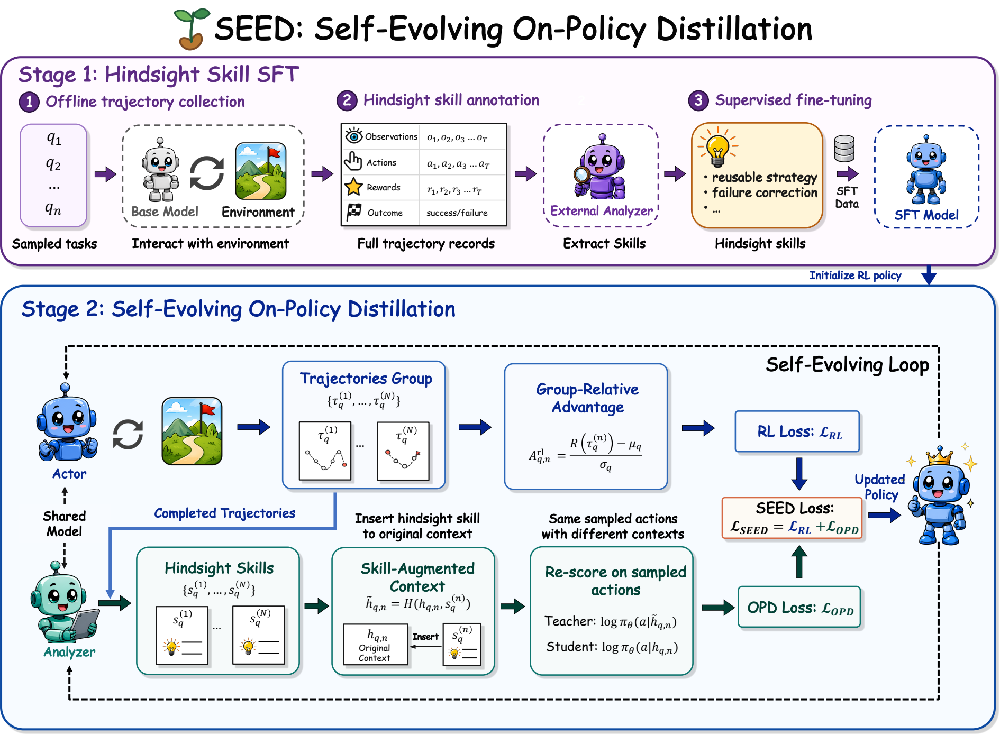
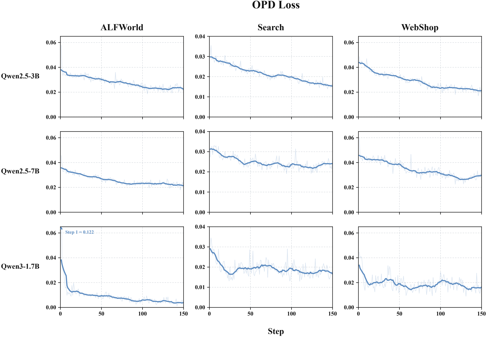
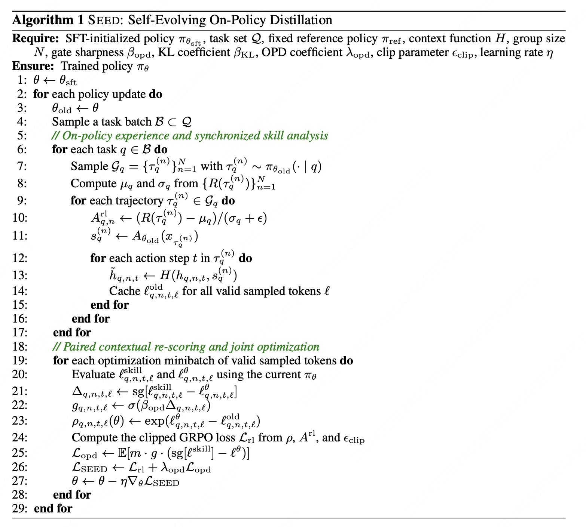
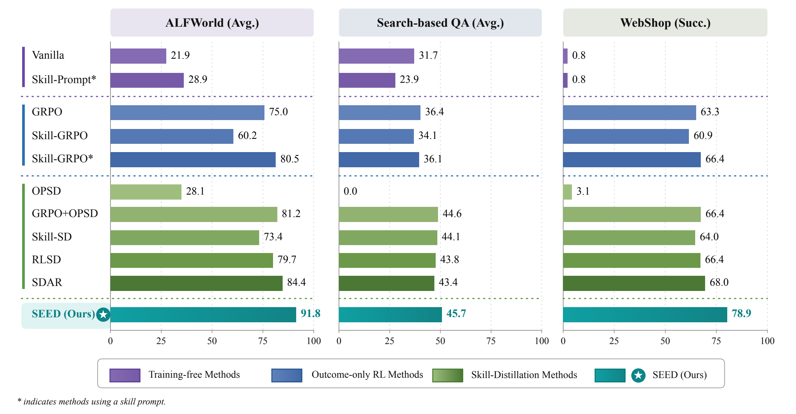
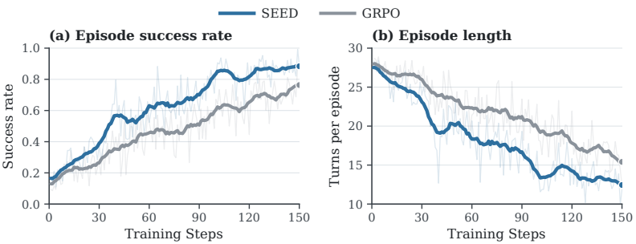
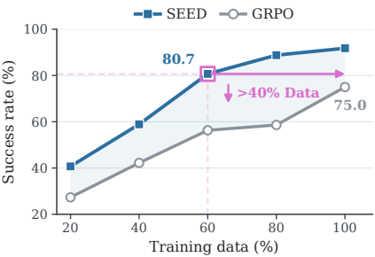
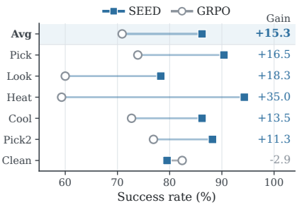
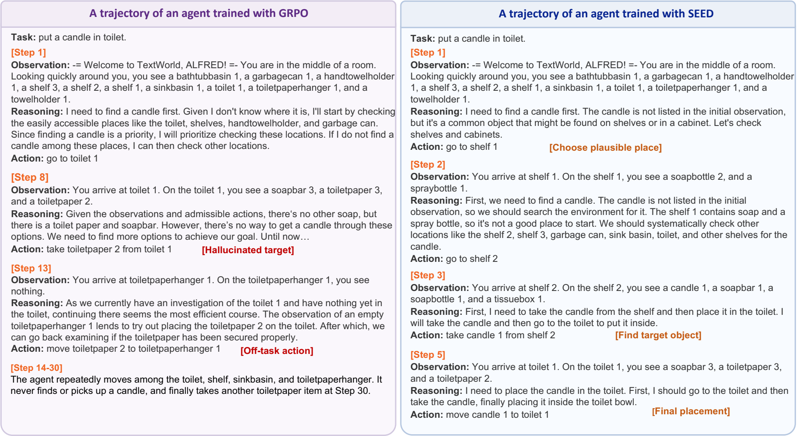

# SEED：把长轨迹 Agent RL 里的“事后复盘”，变成可训练的 token 级监督

做 Agent RL，最常见的一种无力感其实很像带新人：你知道他最后这单没做成，但你很难把问题精确落到“第 7 步看漏了信息”“第 11 步调用工具太早”“第 15 步明明该收敛却还在乱试”这种粒度上。

这正是 long-horizon agent 的训练难点。环境给你的往往只是 episode 结束时的一个结果：成功，或者失败；分高一点，或者分低一点。可模型真正要学的，却是一长串 token 级决策。中间到底哪一步值得鼓励，哪一步应该修正，普通 outcome-based RL 给得并不细。

完整轨迹里其实藏着一类普通 on-policy RL 很难直接利用的信息：哪些步骤构成了可复用 workflow，哪些 observation 真正改变了后续决策，哪些失败来自局部错误而不是整条轨迹都无效。SEED 抓住的正是这部分 hindsight information。它先把已经完成的 on-policy trajectories 转成自然语言 hindsight skills，再保持原始 sampled actions 不变，分别在普通上下文和 skill-augmented 上下文下对同一批 action tokens 重打分，把由 skill 引起的概率偏移转换成 dense token-level OPD signal，并和 outcome-based RL 目标一起优化回策略参数里。

下面这张方法图对应了一条闭环机制：当前 policy 一边收集轨迹，一边充当 analyzer 提炼 hindsight skills；策略更新后，决策能力和 skill analysis 能力又会一起增强。训练时使用的 skill 只作为 privileged supervision 存在，推理阶段既不需要外部 memory，也不需要额外 prompt。

## 一、SEED 的整体方法：两阶段训练，加一条会自演化的 hindsight 监督闭环

如果只看表面，这篇论文很容易被误读成“给 agent 加 skill prompt”。真正的区别在于，SEED 里的 skill 并不是长期挂在推理时上下文里的外部提示，而是训练阶段的 privileged supervision。模型先学会从完整轨迹里提炼 hindsight skill，再利用这段 skill 改变同一批 sampled actions 的概率分布，把这种概率偏移蒸馏回策略。

### 1. 阶段一：Hindsight-Skill SFT

第一阶段先做一个带数据构造的 SFT。先看离线数据是怎么来的。设训练任务集合为：

$$
\mathcal{Q}_{\mathrm{sft}}=\{q_j\}_{j=1}^{M}
$$

对每个任务 $q_j$，base policy $\pi_{\theta_{\mathrm{base}}}$ 会独立 rollout $K_0$ 次，得到该任务对应的一组完成轨迹：

$$
\mathcal{B}_j=
\left\{\tau_{j,k}\right\}_{k=1}^{K_0},
\qquad
\tau_{j,k}\sim \pi_{\theta_{\mathrm{base}}}(\cdot\mid q_j)
$$

把所有任务上的 rollout 合起来，就得到离线轨迹池：

$$
\mathcal{B}=\bigcup_{j=1}^{M}\mathcal{B}_j
$$

这些轨迹都来自普通 agent-environment interaction，采样时还没有 skill augmentation。

然后是 hindsight skill标注。论文默认配置是：

- 采样 180 个训练任务
- 每个任务 rollout 8 条轨迹
- 一共得到 1440 条 completed trajectories

外部轨迹分析器（论文用的GLM5.2）会对每条完成轨迹生成 hindsight skill：

$$
s_\tau=A_{\mathrm{ext}}(\tau)
$$

其中 $A_{\mathrm{ext}}$ 是外部轨迹分析器，$s_\tau$ 是从完整轨迹 $\tau$ 中总结出的 hindsight skill。成功轨迹里，这段 skill 往往会概括可复用 workflow、有效观察顺序或任务推进策略；失败轨迹里，它更像是对错误模式的修正规则，告诉模型下次应该避开什么。

只有格式校验通过的样本才会被保留。设有效性标记 $v_\tau\in\{0,1\}$，那么监督数据集写成：

$$
\mathcal{D}_{\mathrm{sft}}=
\left\{(x_\tau,s_\tau):\tau\in\mathcal{B}, v_\tau=1\right\}
$$

其中：

- $x_\tau$ 是完整轨迹序列化后的分析输入
- $s_\tau$ 是对应的 hindsight skill

SFT 目标就是标准的自回归负对数似然：

$$
\mathcal{L}_{\mathrm{sft}}(\theta)=
-\mathbb{E}_{(x_\tau,s_\tau)\sim\mathcal{D}_{\mathrm{sft}}}
\left[
\sum_{\ell=1}^{|s_\tau|}
\log \pi_\theta(s_{\tau,\ell}\mid x_\tau,s_{\tau,<\ell})
\right]
$$

其中 $s_{\tau,\ell}$ 表示 hindsight skill 的第 $\ell$ 个 token。训练方式仍然是标准的 autoregressive next-token prediction；变化发生在监督目标上：模型学习的已经不是“直接完成任务”，而是“看完整条轨迹后，能否提炼出可复用的行为指导”。

训练完成后得到的 checkpoint 记作 $\theta_{\mathrm{sft}}$，后续 RL 阶段会用它来同时初始化 actor policy 和 synchronized analyzer。
### 2. 阶段二：Self-Evolving On-Policy Distillation

第二阶段才是 SEED 的方法主体。每一轮 policy update 开始时，先把当前策略冻结成 $\pi_{\theta_{\mathrm{old}}}$。然后它同时扮演两种角色：

- actor：在环境里 rollout，采 on-policy trajectories
- analyzer：对这些刚采回来的完整轨迹生成 hindsight skill

对每个任务 $q$，旧策略先采样一组轨迹：

$$
\mathcal{G}_q=
\left\{\tau_q^{(1)},\tau_q^{(2)},\ldots,\tau_q^{(N)}\right\},
\qquad
\tau_q^{(n)}\sim\pi_{\theta_{\mathrm{old}}}(\cdot\mid q)
$$

然后，同一个旧策略$\theta_{\mathrm{old}}$又作为 analyzer，对每条完成轨迹生成 hindsight skill：

$$
 s_q^{(n)} = A_{\theta_{\mathrm{old}}}\bigl(x_{\tau_q^{(n)}}\bigr)
$$

因为 analyzer 就是当前 policy 的同步快照，随着策略更新：
- 它采到的轨迹会变
- 它总结 hindsight 的能力也会变
- 经验分布及其反馈监督机制也会一起发生演变

## 二、SEED 怎么把 hindsight skill 变成 token 级监督？

### 1. 它保留原始 sampled action，只做 paired re-scoring

对某条轨迹在 step $t$ 的普通轨迹 $h_{q,n,t}$，先通过上下文增强函数把 skill 注入进去：

$$
\tilde{h}_{q,n,t}=H(h_{q,n,t},s_q^{(n)})
$$

原始采样动作 $a_{q,n,t}$ 被拆成 token 序列，$ L_{q,n,t} $ 代表token序列长度：

$$
 a_{q,n,t}=(a_{q,n,t,1},\ldots,a_{q,n,t,L_{q,n,t}})
$$
对同一组 sampled action tokens，在两种上下文下分别求 log-prob：

普通 student 分支：

$$
\ell^\theta_{q,n,t,\ell}=
\log \pi_\theta(a_{q,n,t,\ell}\mid h_{q,n,t}, a_{q,n,t,<\ell})
$$

skill-conditioned teacher 分支：

$$
\ell^{\mathrm{skill}}_{q,n,t,\ell}=
\log \pi_\theta(a_{q,n,t,\ell}\mid \tilde{h}_{q,n,t}, a_{q,n,t,<\ell})
$$

teacher 和 student 对的是同一组 sampled tokens，不会出现teacher 换了轨迹，student 还在另一条轨迹学的对齐问题。teacher的输入上下文中有hindsight skill，student的输入上下文没有。

### 2. 用 log-prob shift 表示 hindsight skill 的影响

定义 skill-induced log-probability shift：

$$
\Delta_{q,n,t,\ell}=
\operatorname{sg}\left[
\ell^{\mathrm{skill}}_{q,n,t,\ell}-\ell^\theta_{q,n,t,\ell}
\right]
$$

这里 sg 是 stop-gradient。这个量的含义可以理解成：
- 如果 skill 注入后，这个 token 的概率上升，说明 hindsight 更支持它
- 如果概率下降，说明 hindsight 不太支持它

SEED 没有把 hindsight skill 当成 hard label，它真正关心的是：这段 hindsight skill 是否改变了模型对当前 token 的偏好。换句话说，就是把自然语言反思投影成了对动作分布的局部偏置。

### 3. 再把概率差映射成 gate
定义 confidence gate：

$$
 g_{q,n,t,\ell}=
 \sigma(\beta_{\mathrm{opd}}\Delta_{q,n,t,\ell})
$$

其中：
- $\sigma$ 是 sigmoid
- $\beta_{\mathrm{opd}}$ 控制门控的锐度
- hindsight skill 强烈支持某个 token，$g$ 就大
- hindsight skill 不支持，$g$ 就小

OPD 损失：

$$
\mathcal{L}_{\mathrm{opd}}(\theta)=
\mathbb{E}_{q,n,t,\ell}
\left[
 m_{q,n,t,\ell}\cdot g_{q,n,t,\ell}\cdot
 \bigl(
 \operatorname{sg}[\ell^{\mathrm{skill}}_{q,n,t,\ell}] - \ell^\theta_{q,n,t,\ell}
 \bigr)
\right]
$$

这里 $m_{q,n,t,\ell}$ 是 valid token mask。只对实际生成的、有语义意义的动作token计算损失和梯度。

梯度为：

$$
\nabla_\theta \mathcal{L}_{\mathrm{opd}}=
-\mathbb{E}_{q,n,t,\ell}
\left[
 m_{q,n,t,\ell}\cdot g_{q,n,t,\ell}\cdot
 \nabla_\theta \ell^\theta_{q,n,t,\ell}
\right]
$$

因为 gate 和 teacher log-prob 都做了 stop-gradient，所以它本质上等价于一个 gate-weighted NLL。更准确地说，策略模型提升概率的重点，会落在那些被 hindsight skill 支持、因而获得更大 gate 的 on-policy tokens 上。

下图展示了 OPD loss 在大多数设置下都会从初值逐步下降，并在后期稳定下来。较低的 OPD loss 表示普通上下文下的策略，越来越愿意给那些受到 hindsight supervision 支持的动作分配更高概率。结合 success rate 的上升，这组曲线说明 SEED 的 self-evolving loop 是稳定的，hindsight skill 提供的行为指导也在持续被策略模型内化。

## 三、SEED 相当于在 GRPO 上再加一条更细的监督路径

SEED 没有把 outcome-based RL 扔掉，它是在 GRPO 的损失之上再加一个 OPD 辅助项。

对每个任务的轨迹组 $\mathcal{G}_q$，先算 group mean 和 std：

$$
\mu_q=
\frac{1}{N}\sum_{n=1}^{N}R(\tau_q^{(n)}),
\qquad
\sigma_q=
\sqrt{\frac{1}{N}\sum_{n=1}^{N}\left(R(\tau_q^{(n)})-\mu_q\right)^2}
$$

然后得到 trajectory-level 的 group-relative advantage：

$$
A^{\mathrm{rl}}_{q,n}=
\frac{R(\tau_q^{(n)})-\mu_q}{\sigma_q+\epsilon}
$$

再把它广播到有效 token：

$$
A^{\mathrm{rl}}_{q,n,t,\ell}=A^{\mathrm{rl}}_{q,n}m_{q,n,t,\ell}
$$

策略比率写成：

$$
\rho_{q,n,t,\ell}(\theta)=
\exp\bigl(\ell^\theta_{q,n,t,\ell}-\ell^{\mathrm{old}}_{q,n,t,\ell}\bigr)
$$

对应的 RL 项就是带 clip 的 group-relative policy objective：

$$
\mathcal{L}_{\mathrm{rl}}(\theta)=
-\mathbb{E}_{q,n,t,\ell}
\left[
\min\Bigl(
\rho_{q,n,t,\ell}(\theta)A^{\mathrm{rl}}_{q,n,t,\ell},
\operatorname{clip}(\rho_{q,n,t,\ell}(\theta),1-\epsilon_{\mathrm{clip}},1+\epsilon_{\mathrm{clip}})A^{\mathrm{rl}}_{q,n,t,\ell}
\Bigr)
\right]
+\beta_{\mathrm{KL}}D_{\mathrm{KL}}
$$

最终联合目标为：

$$
\mathcal{L}_{\mathrm{SEED}}(\theta)=
\mathcal{L}_{\mathrm{rl}}(\theta)+
\lambda_{\mathrm{opd}}\mathcal{L}_{\mathrm{opd}}(\theta)
$$

可以把 SEED 理解成：

- GRPO 负责轨迹级 outcome 优化
- OPD 负责 token 级 hindsight supervision

前者解决“整条轨迹哪条更好”，后者解决“同一条轨迹里哪些局部 decision 更值得强化”。

## 四、把算法流程压成一句话，就是下面这张伪代码

下面这张图对应的是原论文给出的算法伪代码。它把 SEED 的训练循环拆成两段：
1. 用旧策略采轨迹，并同步生成 hindsight skill
2. 用当前可训练策略，对同一批 sampled tokens 在普通上下文和 skill 上下文下重打分，再联合优化 RL loss 和 OPD loss

从训练流水线角度看，SEED 的一个 update 可以拆成：

- rollout
- analyze trajectory
- rebuild teacher context
- re-score sampled tokens
- compute GRPO objective
- compute OPD objective
- joint update

## 五、实验结果

### 1. 先看主结果：三类长轨迹任务都受益，而且跨模型规模成立

论文在 ALFWorld、Search-based QA、WebShop 这三类任务上都报告了稳定增益。前两者分别对应文本环境中的长程交互和 search-augmented QA，后者对应多步网页导航与购买决策。任务形态差异很大，但 SEED 的提升方向是一致的。

如果把 aggregate 指标单独拎出来看，SEED 相比 GRPO 的提升会更直观：

| Backbone | ALFWorld Avg | Search Avg | WebShop Score | WebShop Success |
| --- | --- | --- | --- | --- |
| Qwen2.5-3B | 75.0 → 91.8（+16.8） | 36.4 → 45.7（+9.3） | 79.8 → 88.5（+8.7） | 63.3 → 78.9（+15.6） |
| Qwen2.5-7B | 81.2 → 96.1（+14.9） | 42.0 → 48.6（+6.6） | 80.9 → 89.7（+8.8） | 72.6 → 78.1（+5.5） |
| Qwen3-1.7B | 46.1 → 92.0（+45.9） | 40.8 → 42.2（+1.4） | 67.3 → 87.1（+19.8） | 38.3 → 77.3（+39.0） |

这里最有意思的现象有两点。第一，提升覆盖了三种不同类型的 agent 任务，所以它不是某一个 benchmark 的特例。第二，较小模型的收益尤其明显，Qwen3-1.7B 在 ALFWorld 和 WebShop 上的提升都非常大，这说明 hindsight supervision 对 credit assignment 粗糙、探索噪声又更大的小模型尤其有帮助。换句话说，SEED 带来的并不只是「多一点训练」，而是让每条轨迹都提供了更细粒度的优化信息。

从对比方法也能看出这一点。只在测试时外挂 skill 的 Skill-Prompt，或者把 skill 带进 RL 但仍主要依赖 outcome 优化的 Skill-GRPO，并没有稳定追平 SEED。静态蒸馏方法如 OPSD、Skill-SD、RLSD、SDAR 也会带来收益，但整体上仍然很难同时在三类任务上都压过 SEED。SEED 的优势不只是「看到了 skill」，而是把 hindsight skill 的行为效应真正蒸馏进了策略参数。

### 2. 再看训练动态：它赢得更早，而且伴随更短的交互路径

主结果告诉我们它最后更强，training dynamics 则说明它为什么更强。论文给出的 ALFWorld 曲线里，SEED 的 success rate 很早就和 GRPO 拉开差距，同时平均 episode length 下降得也更快。

这张图有两个值得一起看的信号。第一个信号是成功率上升更早，说明 SEED 更快进入有效学习阶段；第二个信号是 episode length 同步下降，说明它减少的不是有效推理，而是无效探索和反复试错。这说明 OPD 提供的 token-level hindsight signal，正在更早地修正轨迹中的局部行为偏差。对长轨迹 agent 来说，这一点很重要。很多时候模型最后失败，并不是完全不会做，而是中间多绕了几步、搜错了地方、顺序走反了。SEED 的训练曲线之所以更陡，恰好说明 hindsight supervision 更擅长处理这种中段偏航的问题。

### 3. 样本效率说明：每条 completed trajectory 被榨出了更多监督价值

如果一种方法只是靠更长训练时间把性能磨上去，它在 sample efficiency 上通常不会太好看。SEED 在这一点上反而给出了比较强的证据：同样的数据预算下，它能比 GRPO 提前达到更高水平。

ALFWorld 上，GRPO 用满 100% 数据时平均成绩是 75.0，而 SEED 只用 60% 数据就到了 80.7；SEED 用 40% 数据时达到 58.9，已经接近 GRPO 用 80% 数据时的 58.6。WebShop 上也有相似趋势：GRPO 在 100% 数据时 success 是 63.3，SEED 在 80% 数据时已经达到 75.0，100% 数据时进一步升到 78.9。

这组结果说明：SEED 没有改变一条轨迹的环境奖励，但它改变了一条轨迹能被训练系统利用的程度。原本 outcome-only RL 只能从轨迹末端拿到一个粗粒度信号，SEED 则会在轨迹结束后再做一轮 hindsight 分析，把可复用 workflow、决定性观察和失败规避规则折回到 token-level distillation 里。这样一来，同样一条 completed trajectory，能提供的 supervision 就明显更多了。

### 4. 泛化和案例分析说明：它学到的是更稳的策略模式

如果一种方法只是更会记训练集，到了 unseen 环境通常很容易掉下来。SEED 在 ALFWorld unseen split 上的表现给出的判断更好一些。

在 Qwen2.5-3B 上，GRPO 的 unseen 平均成功率是 70.9，SEED 提升到 86.2，平均多出 15.3 个点。其中提升最明显的类别包括 Heat（+35.0）、Look（+18.3）和 Pick（+16.5）。这说明 SEED 学到的并不只是训练轨迹里的表面模式，更接近一类可迁移的行为偏置：遇到什么任务，先看什么、先排除什么、搜索顺序怎么组织，都会更稳定。

论文给的 ALFWorld case study 也支持这个判断。GRPO 版本会先去目标容器，再去找目标物体，中间还会拿无关物品，然后掉进无效循环；SEED 则会先去更合理的储物位置搜索，找到目标物体后再完成放置。

这种差别很像把“会不会做”拆成了“会不会按更像人的顺序做”。前者决定最终能不能成，后者决定中间会不会绕、会不会卡、会不会把有限的交互步数浪费在错误方向上。SEED 的泛化和案例都在说明，它优化到的并不只是一个更高的 reward，而是一种更稳的局部决策模式。

### 5. 最后看消融：on-policy、自演化、SFT 底座，三者缺一块都会掉

论文在 ALFWorld 上做了三组消融，完整 SEED 的平均成绩是 91.8。去掉 hindsight-skill SFT 后，平均降到 86.0；去掉 self-evolving OPD 后，平均降到 87.0；把 on-policy skill 换成静态离线 skill 后，平均降到 84.4。

把这三项放在一起看，信息非常明确。

- Hindsight-skill SFT 负责给 actor 和 analyzer 建立共同的轨迹分析能力底座，没有这一步，后续 RL 虽然还能学，但监督质量会明显下降。
- Self-evolving OPD 负责让 hindsight supervision 随着当前策略一起刷新；只靠第一阶段的一次性 skill 学习，强度还不够。
- 用静态 skill 代替 on-policy skill 的跌幅最大，说明 hindsight supervision 和当前策略访问到的状态、动作、失败模式之间，确实存在强耦合关系。

## 八、论文总结

- 和 Skill Prompt 这类方法相比，SEED 的 skill 不在推理阶段外挂使用。训练时构造 skill-augmented context，只是为了观察 hindsight skill 会怎样改变同一批 sampled actions 的概率分布，再把这种概率偏移蒸馏回普通 policy。也正因为如此，它最终学到的是参数内化后的行为偏置，而不是一套部署时仍需随身携带的外部提示。

- 和普通 GRPO 相比，SEED 增加的不是新的环境奖励，而是一条更细粒度的 hindsight supervision 路径。GRPO 负责在轨迹层面区分“哪条更好”，SEED 则进一步回答“同一条轨迹里哪些局部 token 更值得强化”。这也是它能在长轨迹任务上更早拉开训练曲线、同时缩短平均交互长度的核心原因。

- 和静态蒸馏方法相比，SEED 的关键区别在于 synchronized analyzer。teacher 不是一个固定外部模型，而是当前 policy 的同步副本。轨迹是当前策略采出来的，skill 也是当前策略分析出来的，辅助监督因此始终贴着当前访问分布更新，teacher staleness 的问题被显著减轻。

- 这篇论文给出的更大启发在于，复盘不一定只是分析材料，也可以直接变成训练信号。很多工作会保存 trajectory replay、失败样例和运行日志，但通常只把它们用来做 debug 或 case study。SEED 则把这些 hindsight information 进一步转成 teacher-side probability shift，再折回 token-level distillation。自然语言 skill 在这里不是 memory 组件，而是训练时的 privileged supervision。

- 当然，这条路线并不是没有代价。第一阶段的 hindsight-skill SFT 依赖一个可用的轨迹分析器；第二阶段又要额外承担完整轨迹分析、skill 上下文重建和 paired re-scoring，训练链路明显比普通 GRPO 更重，本质上是在用更多算力换取更密的监督。

- 它的上限最终仍然受 hindsight skill 质量约束。SEED 能保证的是监督结构更合理、和 on-policy 采样更一致，但不能自动保证每条复盘都足够深刻。如果 skill 提炼得浅，或者归因本身就抓偏了，那么 OPD 提供的增益也会随之减弱。

## 附：训练超参数配置

### 1. RL

| 参数 | 取值 |
| --- | --- |
| 训练硬件 | 8 张 Nvidia A800 80G GPU |
| 训练步数 | 150 |
| 训练批大小 | ALFWorld / WebShop 为 16；Search-based QA 为 128 |
| 验证批大小 | ALFWorld / WebShop 为 128；Search-based QA 为 512 |
| Rollout 组大小 $N$ | 8 |
| 学习率 | $1\times10^{-6}$ |
| 学习率预热 | 0.1 |
| PPO mini-batch | ALFWorld 为 256；WebShop 为 64；Search-based QA 为 512 |
| Actor 每卡 micro-batch | ALFWorld 为 32；WebShop 为 8；Search-based QA 为 16 |
| Rollout log-prob 每卡 micro-batch | ALFWorld 为 32；WebShop 为 16；Search-based QA 为 32 |
| Reference log-prob 每卡 micro-batch | ALFWorld 为 32；WebShop 为 16；Search-based QA 为 32 |
| PPO clip 系数 $\epsilon_{\mathrm{clip}}$ | 0.2 |
| OPD gate 系数 $\beta_{\mathrm{opd}}$ | 5.0 |
| OPD loss 系数 $\lambda_{\mathrm{opd}}$ | 0.01 |
| KL 系数 $\beta_{\mathrm{KL}}$ | 0.01 |
| KL loss 系数 | ALFWorld / WebShop 为 0.01；Search-based QA 为 0.001 |
| KL 类型 | ALFWorld / Search-based QA 为 low_var_kl；WebShop 未单独披露 |
| 熵系数 | ALFWorld / WebShop 未显式设置；Search-based QA 为 0 |
| 非法动作惩罚系数 | ALFWorld / WebShop 为 0.1；Search-based QA 为 0.01 |
| 最大输入长度 | ALFWorld 为 2048；WebShop / Search-based QA 为 4096 |
| 最大输出长度 | 512 |
| 最大交互步数 | ALFWorld 为 30；WebShop 为 15；Search-based QA 为 4 |
| 历史长度 | ALFWorld 为 5；WebShop 为 2；Search-based QA 为 4 |
| Analysis context length | 16384 |
| Analysis max completion tokens | 4096 |
| Analysis max model length | 20480 |
| 每条轨迹最多Skill数 | ALFWorld / WebShop 为 5；Search-based QA 为 2 |
| 训练后端 | verl.trainer.main_ppo + vllm |

### 2. SFT

| 参数 | 取值 |
| --- | --- |
| 分布式框架 | verl.trainer.fsdp_sft_trainer |
| 训练硬件 | 8 张 Nvidia A800 80G GPU |
| 训练轮数 | 3 |
| 学习率 | 5e-6 |
| 训练批大小 | 8 |
| 每卡micro-batch大小 | 1 |
| 梯度检查点 | 开启 |
| 序列并行大小 | ulysses_sequence_parallel_size=1 |
| 最大序列长度 | ALFWorld 为 8192；WebShop / Search 为 12288 |
| 截断方式 | ALFWorld 为 left；WebShop / Search 为 truncation=error |
