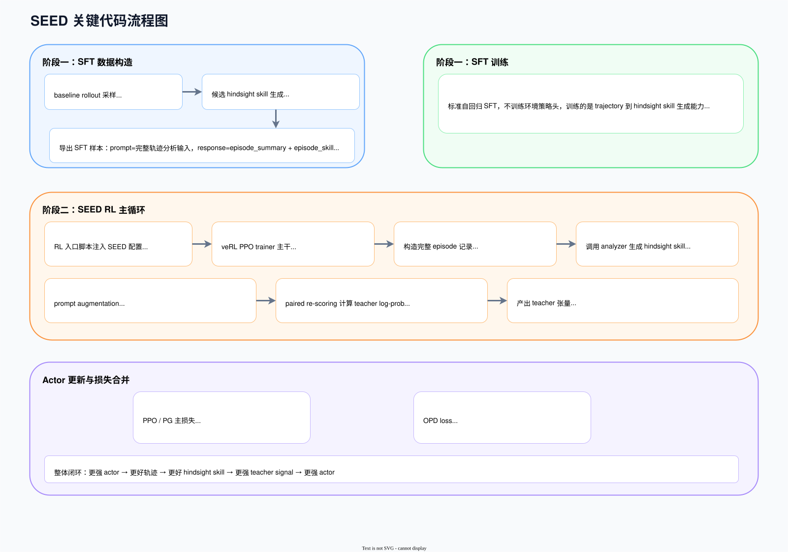

# 关键代码

## 项目流程概览

代码实现按论文原文可以统一成两个阶段：

- Stage 1: Hindsight-Skill SFT
- Stage 2: Self-Evolving OPD

这份实现里会直接用到几类可信框架和关键技术：

|框架或技术|在项目里的位置|作用|
|---|---|---|
|veRL|verl/、scripts/sft/_common/trainer.sh、examples/seed_trainer|训练主框架，承接 SFT、rollout、log-prob 重算、PPO/OPD 更新|
|PyTorch|全项目底层|模型训练、张量计算、loss 反传|
|FSDP|verl.trainer.fsdp_sft_trainer、RL actor/ref 配置|分布式参数切分，用于 SFT 和 RL 阶段的大模型训练|
|torchrun|scripts/sft/_common/trainer.sh|启动多进程分布式 SFT|
|vLLM|policy_vllm backend、rollout worker|在 RL 阶段承担 rollout 和 policy-as-analyzer 的生成后端|

代码执行主线如下：

|阶段|作用|关键文件|
|---|---|---|
|Stage 1：SFT 数据构造|采样 baseline trajectory，调用 analyzer 生成 hindsight skill，导出 parquet|scripts/sft/_common/pipeline.py、scripts/sft/search/pipeline.py、scripts/sft/alfworld/pipeline.py|
|Stage 1：SFT 训练|用导出的 prompt/response 样本训练 hindsight-skill 生成器|scripts/sft/_common/trainer.sh|
|Stage 2：轨迹分析|把完整轨迹变成 episode skill 和 step skill|seed/analysis.py|
|Stage 2：teacher signal 构造|把 hindsight skill 变成 teacher log-prob 和 mask，相关配置由 examples/seed_trainer/_common/alfworld.sh、examples/seed_trainer/_common/search.sh 注入 trainer|verl/trainer/ppo/ray_trainer.py|
|Stage 2：Actor 更新|把 PPO 和 OPD 两种损失接到一起|verl/workers/actor/dp_actor.py|

代码链路如下图：

## 一、项目整体结构与入口

项目底层骨架来自 veRL，SEED 方法以增量方式接入现有训练框架。

相关目录如下：

|目录或文件|角色|
|---|---|
|scripts/sft|阶段一的数据构造和 SFT 训练入口|
|seed|SEED 自己新增的 hindsight analysis、prompt augmentation、skill reward 逻辑|
|examples/seed_trainer|不同任务的 RL 启动脚本|
|verl|rollout、teacher scoring 和 loss 反传的主干框架|

文档按下面顺序展开：

1. Stage 1：SFT 数据构造，完整轨迹怎样变成 hindsight-skill 监督样本
2. Stage 1：SFT 训练，这些样本怎样把模型训练成 analyzer-capable policy
3. Stage 2：seed/analysis.py，当前策略怎样兼做 analyzer，把 trajectory 变成 hindsight skill
4. Stage 2：ray_trainer.py，trainer 怎样结合训练脚本注入的配置，把 hindsight skill 变成 teacher signal
5. Stage 2：dp_actor.py，actor 怎样把 PPO 和 OPD 合并进一次更新

## 二、Stage 1：Hindsight-Skill SFT

论文里的 Stage 1 对应两部分代码：

- SFT 数据构造：scripts/sft/_common/pipeline.py 及任务定制 pipeline
- SFT 训练：scripts/sft/_common/trainer.sh

这一阶段的目标，是把模型训练成一个能读取完整 trajectory、输出 episode_summary 和 episode_skill 的 analyzer-capable policy。

### 1. SFT 数据构造

阶段一的数据构造位于 pipeline。

公共流程在 scripts/sft/_common/pipeline.py，任务定制版分别在：

- scripts/sft/alfworld/pipeline.py
- scripts/sft/search/pipeline.py

相关函数如下。

#### 1.1 run_rollout_specs

公共实现见 scripts/sft/_common/pipeline.py:652。

函数职责如下：

- 根据任务规格创建环境 manager
- 用 policy endpoint 驱动 agent rollout
- 逐步记录 observation、prompt、model response、executed action、reward、done 等字段
- 把一整条 episode 存进 trajectories

如果当前 rollout 规格里带有 episode_skill，函数会调用 seed/prompting.py 的 build_augmented_observation_text，把 skill 注入 observation prompt。SFT 阶段的数据构造支持普通上下文和 skill 增强上下文两种输入格式。

#### 1.2 build_candidate_skill_record

见 scripts/sft/_common/pipeline.py:941。

函数内容包括：

- 把 rollout trajectory 转成 analyzer 需要的 steps
- 构造 episode analysis prompt
- 调用 SEEDEpisodeAnalyzer
- 解析 JSON 输出
- 存下 episode_summary、episode_skill、原始输出、解析状态和报错信息

这一步生成的记录面向轨迹总结任务，后续训练目标是从已完成轨迹中生成可复用规则。

#### 1.3 generate_candidate_skills

见 scripts/sft/_common/pipeline.py:1067。

这个函数把前面采回来的所有 baseline rollouts 扔进线程池，逐条调用 build_candidate_skill_record。输出是 candidate_skills.jsonl。

这一层保留 candidate skill 中间记录。项目先保存 analyzer 输出，再导入训练器，便于：

- 看 parse 成功率
- 看 skill 文本质量
- 追踪某条 skill 对应的源轨迹
- 后续做 validation 或重新导出

#### 1.4 build_sft_exports

见 scripts/sft/_common/pipeline.py:1286。

这个函数保留 accepted 样本，并导出：

- sft_episode_skill_all.jsonl
- sft_episode_skill_train.parquet
- sft_episode_skill_val.parquet

阶段一输出 hindsight-skill 生成所需的监督样本。

### 2. SFT 训练入口

SFT 的公共训练入口在 scripts/sft/_common/trainer.sh。这个脚本负责把已经导出的 hindsight-skill 样本交给 veRL 的 FSDP SFT trainer。

这个脚本约定了 SFT 样本格式：

- prompt：完整轨迹序列化后的分析输入
- response：目标 JSON，里面通常包含 episode_summary 和 episode_skill

脚本里做了四件事：

1. 读取训练数据与验证数据
2. 组装 veRL 的 FSDP SFT 参数
3. 用 torchrun 启动多进程训练
4. 训练结束后，把最新 checkpoint 导出成后续 RL 可直接加载的模型目录

先看数据侧关键参数。

|参数|作用|
|---|---|
|data.train_files|训练集 parquet 路径，默认是 sft_episode_skill_train.parquet|
|data.val_files|验证集 parquet 路径，默认是 sft_episode_skill_val.parquet|
|data.prompt_key=prompt|指定样本里哪一列作为模型输入|
|data.response_key=response|指定样本里哪一列作为监督输出|
|data.max_length|单条样本的最大总长度|
|data.truncation|超长样本的处理方式，默认是 error|
|data.train_batch_size|训练集 batch-size|
|data.micro_batch_size_per_gpu|单卡 micro-batch-size，用于梯度累积|

再看模型侧参数，SFT 训练目标是让模型获得「读完整轨迹并输出 hindsight skill」的生成能力。

|参数|作用|
|---|---|
|model.partial_pretrain|SFT 的起始模型路径|
|model.enable_gradient_checkpointing=True|打开 gradient checkpointing，降低显存占用|
|ulysses_sequence_parallel_size|长序列训练时的 sequence parallel 配置|

然后是优化与训练调度参数。

|参数|作用|
|---|---|
|optim.lr|SFT 学习率，脚本里通过 LR 变量传入|
|trainer.total_epochs|总训练轮数，默认 TOTAL_EPOCHS=3|
|NPROC_PER_NODE|分布式训练进程数，默认 8|
|TRAIN_BATCH_SIZE|全局 train batch-size，默认 8|
|MICRO_BATCH_SIZE_PER_GPU|单卡 micro-batch-size，默认 1|
|TRAINER_LOGGER|日志后端，默认 console + wandb|

然后是训练指令：

- 用 torchrun --nproc_per_node=$NPROC_PER_NODE 启动多进程训练
- 每个进程跑 veRL 的 fsdp_sft_trainer

Stage 1 执行标准的自回归 SFT：输入完整轨迹，输出结构化 hindsight analysis。输出是SFT checkpoint，后续用于RL actor 初始化，并作为 trajectory analysis 能力的起点。

## 三、Stage 2：Self-Evolving OPD

论文里的 Stage 2 对应三部分代码：

- 轨迹分析：seed/analysis.py
- teacher signal 构造：verl/trainer/ppo/ray_trainer.py
- Actor 更新：verl/workers/actor/dp_actor.py

这部分对应论文中当前策略同时扮演 actor 和 analyzer，然后把 hindsight skill 的行为效应蒸馏回 ordinary policy 的主循环。

### 1. seed/analysis.py：轨迹分析器

SEED 的方法核心在 seed/analysis.py 的 SEEDEpisodeAnalyzer。

这个类的职责很明确：输入一条完整 episode，输出结构化 hindsight analysis。

#### 1.1 SEEDEpisodeAnalyzer

它支持两种后端：

- openai：调用外部 OpenAI-compatible 接口做分析
- policy_vllm：在 RL 阶段复用当前 on-policy 模型做分析

这正是论文里 current policy 同时扮演 actor 和 analyzer 在工程里的落点。SFT 数据构造阶段通常走 openai，RL 阶段则可以切到 policy_vllm。

#### 1.2 analyze_episode

入口在 seed/analysis.py:309。

这个入口负责分发到 prompt 构造和结果解析逻辑。

#### 1.3 _build_default_episode_analysis_prompt

见 seed/analysis.py:618。

这里把 episode 分成三种模式：

- episode_only
- step_only
- episode_step

并且根据 episode 成败，切换不同的分析目标：

- 成功轨迹：提炼 successful workflow
- 失败轨迹：提炼 avoidance rules

SEED 在这里要求 analyzer 输出 policy-facing skill。提示词里强调：

- 不要写回顾性说明
- 要写成给策略看的行动规则
- step skill 只针对当前决策点

analyzer 的输出直接用于后续 prompt augmentation 和 teacher scoring。

#### 1.4 _parse_analysis_response

见 seed/analysis.py:858。

它会把模型输出解析成统一格式：

|字段|含义|
|---|---|
|episode_summary|对整条轨迹的简短概括|
|episode_skill|作用于整条 episode 的通用技能|
|step_skills|按 step index 索引的局部决策技能|

后面 trainer 构造 teacher signal 时，就是直接消费这个结构。

### 2. ray_trainer.py：teacher signal 构造

SEED teacher signal 的实现位于 verl/trainer/ppo/ray_trainer.py:2348 的 _prepare_seed_teacher_signals。

进入这个函数之前，训练入口脚本会先把 SEED 配置注入 veRL 的 PPO 配置。相关脚本是 examples/seed_trainer/_common/alfworld.sh 和 examples/seed_trainer/_common/search.sh。

先看脚本中的配置。

- algorithm.adv_estimator=seed
  这一项决定 trainer 走 SEED 分支，而不是普通 advantage 分支。

- actor_rollout_ref.actor.opd_loss_coef
  这是 OPD loss 的直接权重。设成 0 时，就算前面已经构造出了 teacher_log_prob，actor update 里也不会把 OPD 项加到 policy loss 上。

- actor_rollout_ref.actor.opd_gate_beta
  这是 OPD gate 的陡峭系数。teacher log-prob 和 ordinary log-prob 的差距，后面要先过一个 sigmoid gate，beta 越大，gate 越接近硬阈值；beta 越小，gate 越平滑。

- algorithm.seed.opd_start_after_steps
  这是 OPD 的启动步数。global step 没到这个阈值之前，trainer 可以先做 trajectory analysis，但不会真正启用 teacher signal 去驱动 OPD。

- algorithm.seed.opd_stop_after_steps
  这是 OPD 的停止步数。超过这个步数后，teacher signal 不再继续参与 OPD update。

- algorithm.seed.enable_analysis
  这是总开关。关闭后，_prepare_seed_teacher_signals 会直接跳过 analysis，teacher_log_prob、critical_step_mask 这些张量都会回填成 0。

- algorithm.seed.selector
  当前实现要求这里走 llm 分支。它的含义是，trajectory 的 hindsight skill 交给 LLM analyzer 生成。

- algorithm.seed.analysis_backend
  这个参数决定“谁来当 analyzer”。openai 表示调用外部 OpenAI-compatible backend；policy_vllm 表示直接复用当前 on-policy 模型，在 rollout worker 上生成 analysis。

- algorithm.seed.analysis_num_workers
  这是 analysis 阶段的并发度。对 openai backend 来说，它对应线程池里同时发多少个 analysis 请求；对 policy_vllm 分支来说，它更多影响批量调度方式。

- algorithm.seed.analysis_max_completion_tokens
  限制 analyzer 单次输出的最大长度。值太小，episode skill 或 step skill 可能被截断；值太大，则 analysis 延迟和成本都会升高。

- algorithm.seed.analysis_max_step_skills_per_traj
  限制每条 trajectory 最多保留多少个 step skill。值越大，teacher signal 能覆盖更多局部决策点；值越小，analysis 会更偏向只保留最关键的几个步骤。

- algorithm.seed.skill_mode
  它先决定 teacher signal 允许使用哪些 skill 来源：
  - episode_only：只保留 episode skill 分支
  - step_only：只保留 step skill 分支
  - episode_step：两类 skill 都允许进入后续 teacher scoring

- algorithm.seed.skill_teacher_mode
  这个参数只在 skill_mode=episode_step 时真正拉开差异：
  - step_priority：当前 step 如果有 step skill，就优先用 step skill；没有时再回·退到 episode skill
  - additive：episode skill 和 step skill 可以同时算，两条 teacher branch 都进入后续比较

这些配置准备好之后，_prepare_seed_teacher_signals 会顺着下面这条执行链路工作。

1. 按 traj_uid 把 rollout batch 里的离散 step 重新拼回完整 trajectory。这里会恢复 step_idx、obs_text、responses、episode_success 等字段，因为 analyzer 的输入单位不是单个 step，而是一整条 episode。对应代码：verl/trainer/ppo/ray_trainer.py:2443-2502。

2. 按当前配置决定哪些 trajectory 要送去分析。enable_analysis 控制是否整体启用，failed_only 相关配置控制是否只分析失败轨迹。论文里同时对 成功轨迹提炼 reusable workflow，失败轨迹提炼 failure-avoidance rule。对应代码：verl/trainer/ppo/ray_trainer.py:2503-2554。

3. 调用 seed/analysis.py 里的 analyze_episode，为每条 trajectory 生成 episode_skill、step_skills、episode_summary 以及对应的解析状态。到这里为止，trainer 手里拿到的还是自然语言 hindsight analysis，还不是 teacher log-prob。对应代码：verl/trainer/ppo/ray_trainer.py:2555-2579。

4. 基于分析结果构造 critical_step_mask 和 teacher 分支输入。这一步先做 trajectory-level gating：只要某条 trajectory 成功产出了可用的 hindsight skill，这条 trajectory 里的全部 rollout step 都会被纳入后续 teacher scoring。对应到论文，可以理解成先确定哪些 on-policy trajectory 拿到了可用的 hindsight skill，后面 ordinary context 和 skill-augmented context 的 paired re-scoring 只在这些 trajectory 对应的 step 上展开。对应代码：verl/trainer/ppo/ray_trainer.py:2580-2732。

5. 调用 build_augmented_observation_text 把 hindsight skill 插回 prompt。episode skill 会插在任务描述附近，作为全局行为约束；step skill 会插在当前行动区域附近，只影响当前决策。接着，select_skill_teacher_sources 会根据 skill_mode 和 skill_teacher_mode 决定当前这个 step 到底计算 episode teacher、step teacher，还是两个都算。对应代码：verl/trainer/ppo/ray_trainer.py:2733-2836。

6. 在 _compute_skill_log_probs 里做 paired re-scoring。这里不会重新采样动作，而是把原 rollout 里已经生成好的 response tokens 直接拼回新的 prompt 后面，只重算这些 token 在 skill-augmented context 下的 log-prob。teacher branch 和 ordinary branch 的差别，只来自 prompt context，不来自 action 序列本身。对应代码：verl/trainer/ppo/ray_trainer.py:2838-3030。

这一实现对应的就是 paired re-scoring：采样动作不变，response token 不变，唯一变化的是上下文是否注入 hindsight skill。因此 teacher 分支和 ordinary policy 分支对比的，是同一个动作序列在不同上下文下的概率差。

最后，这个函数会把下面这些张量写回 batch：

|张量 / 论文里的表示|含义|
|---|---|
|teacher_log_prob / ℓ^skill_{q,n,t,ℓ}|最终用于 OPD 的 teacher log-prob，对应论文里在 skill-augmented context 下对同一 sampled action token 重新计算的 teacher branch log-prob|
|episode_teacher_log_prob|代码里的实现拆分项，只表示 episode skill 分支单独算出来的 teacher log-prob。|
|step_teacher_log_prob|代码里的实现拆分项，只表示 step skill 分支单独算出来的 teacher log-prob。|
|critical_step_mask|代码里的 trajectory-level gating 结果，表示哪些 rollout step 会进入后续 teacher scoring。论文里没有单独定义这个张量。|
|step_skill_mask|代码里的实现掩码，表示哪些 step 最终走了 step skill teacher 分支。论文里没有单独定义这个张量。|
|teacher_signal_mask|代码里的实现掩码，表示哪些 step 存在 teacher supervision。论文里没有直接对应的同名张量；真正进入式 (1) 的 token 级有效位置还要再结合 valid-token mask m_{q,n,t,ℓ}。|

这些张量的快照和异步合并逻辑位于 verl/trainer/ppo/ray_trainer.py:921 与 verl/trainer/ppo/ray_trainer.py:952。ray_trainer.py:921 _build_seed_teacher_signal_snapshot 复制 teacher signal 所需字段，ray_trainer.py:952 _prepare_seed_teacher_signals_async_task 合并异步分析结果。

### 3. verl/workers/actor/dp_actor.py：Actor 更新

teacher signal 由 trainer 计算，反向传播在 verl/workers/actor/dp_actor.py 的 DataParallelPPOActor 中执行。

#### 3.1 PPO 主损失

actor update 的核心入口在 verl/workers/actor/dp_actor.py:853-972。

这一段先对当前 micro-batch 做一次前向，拿到当前策略在 response token 上的 log-prob，然后依次计算 PPO、OPD、KL 和可选的环境辅助损失。最基础的一条主线仍然是 PPO。

PPO 主损失在文档里统一按两层位置来理解：verl/trainer/ppo/core_algos.py:431-492 的 compute_policy_loss 是计算实现，verl/workers/actor/dp_actor.py:897-910 是 actor 侧的调用接入位置。下面这组对应关系说的是 compute_policy_loss 这一层：

- 当前策略 token log-prob：ℓ^θ_{q,n,t,ℓ}，对应代码中的 `log_prob`
- 旧策略 token log-prob：ℓ^old_{q,n,t,ℓ}，对应代码中的 `old_log_prob`
- token 级 importance ratio：ρ_{q,n,t,ℓ}(θ)=exp(ℓ^θ_{q,n,t,ℓ}-ℓ^old_{q,n,t,ℓ})，对应代码中的 `ratio = torch.exp(log_prob - old_log_prob)`
- token 级 advantage：A^rl_{q,n,t,ℓ}，对应代码中的 `advantages`
- valid-token mask：m_{q,n,t,ℓ}，在这段实现里对应代码中的 `response_mask`
compute_policy_loss 的计算顺序是：

1. 先算 negative_approx_kl = log_prob - old_log_prob，再取 exp 得到 ratio。
2. 用 advantages 和 ratio 构造未裁剪项 -advantages * ratio。
3. 再用 PPO clip 区间构造裁剪项。
4. 对 advantage 为负的区域，再套一层 dual-clip 下界。
5. 最后用 response_mask 只聚合有效 token，得到标量 pg_loss。

论文里的 L_rl(θ) 在实现里没有保留一个完全同名的函数，而是落成了 compute_policy_loss(...) 返回的 pg_loss，随后再叠加 entropy、OPD、KL 等额外项。

#### 3.2 OPD loss

代码落点分成两层：

- verl/workers/actor/dp_actor.py:922-948 负责把 OPD 接到 actor 更新里
- verl/trainer/ppo/core_algos.py:505-602 负责计算 OPD 本身

满足以下条件时：

- use_opd_loss 为真
- batch 中存在 teacher_log_prob
- batch 中存在 teacher mask

代码会调用 compute_opd_loss，并：

- 返回 opd_loss
- 返回 gate 相关统计量
- 把 opd_loss_coef 乘以 opd_loss 加到 policy_loss

OPD 的具体实现位于 verl/trainer/ppo/core_algos.py:505 的 compute_opd_loss。调用接口依赖五个输入：

- log_prob
- teacher_log_prob
- response_mask
- opd_step_mask
- gate_beta

这一段和论文第 3.3 节可以直接按下面这张表来对应：

|论文里的量|代码里的实现|位置|说明|
|---|---|---|---|
|ordinary branch：ℓ^θ_{q,n,t,ℓ}|`log_prob`|dp_actor.py:940|当前 actor 在 ordinary context 下对 sampled token 的 log-prob|
|teacher branch：ℓ^skill_{q,n,t,ℓ}|`teacher_log_prob`|ray_trainer.py 先写回 batch，actor 侧在 dp_actor.py:941 读取|skill-augmented context 下重打分得到的 teacher log-prob|
|detached gap：Δ_{q,n,t,ℓ} = sg[ℓ^skill_{q,n,t,ℓ} - ℓ^θ_{q,n,t,ℓ}]|`teacher_gap = (teacher_log_prob - log_prob.detach()).detach()`|core_algos.py:575-576|teacher 和 ordinary 的 detached log-prob 差值|
|confidence gate：g_{q,n,t,ℓ} = σ(β_opd Δ_{q,n,t,ℓ})|`opd_gate = sigmoid(gate_beta * teacher_gap).detach()`|core_algos.py:577-580|把 teacher gap 映射成 [0,1] 的权重|
|valid-token mask：m_{q,n,t,ℓ}|`opd_mask = response_mask * opd_step_mask`|core_algos.py:540-556|代码里比论文多拆了一层 `opd_step_mask`，先做 step 级筛选，再保留有效 response token|
|OPD loss：L_opd(θ) = E[m · g · (sg[ℓ^skill] - ℓ^θ)]|`opd_loss_mat = opd_gate * (teacher_log_prob - log_prob)`，再经 `agg_loss(..., loss_mask=opd_mask)` 聚合|core_algos.py:584-590|teacher 和 gate 都 detach，真正回传梯度的只有 ordinary branch|
